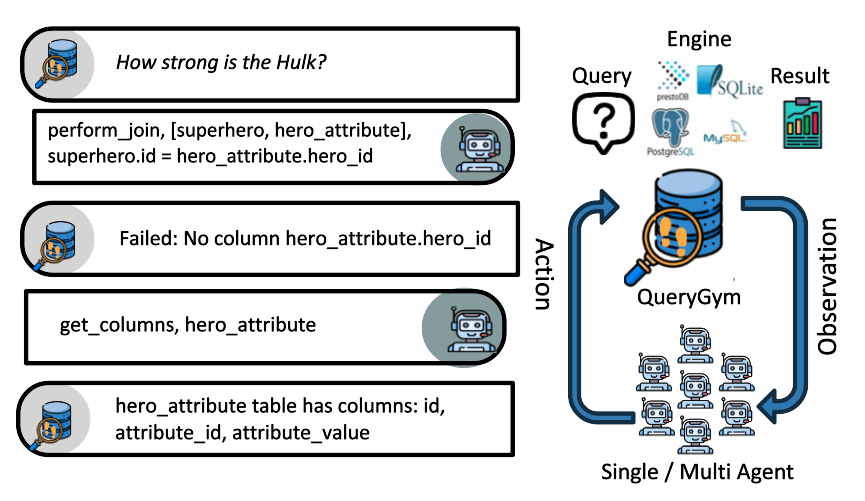

# QueryGym: Step-by-Step Interaction with Relational Databases


<p align="center">
    <a href="https://arxiv.org/abs/2509.21674">📄 Paper</a> •
    <a href="https://www.youtube.com/watch?v=OhPFvCCcWAg">🎬 Demo Video</a> •
    <a href="./getting_started/start_here.ipynb">🚀 Getting Started</a> •
    <a href="#-citation">📜 Citation</a> 
</p>





We introduce QueryGym, an interactive environment for building, testing, and evaluating LLM-based query planning agents. Existing frameworks often tie agents to specific query language dialects or obscure their reasoning; QueryGym instead requires agents to construct explicit sequences of relational algebra operations, ensuring engine-agnostic evaluation and transparent step-by-step planning. The environment is implemented as a Gymnasium interface that supplies observations -- including schema details, intermediate results, and execution feedback -- and receives actions that represent database exploration (e.g., previewing tables, sampling column values, retrieving unique values) as well as relational algebra operations (e.g., filter, project, join). We detail the motivation and the design of the environment. In the demo, we showcase the utility of the environment by contrasting it with contemporary LLMs that query databases. QueryGym serves as a practical testbed for research in error remediation, transparency, and reinforcement learning for query generation. 


## Project Structure


```
/
├── .env                     # File with environment variables
├── README.md                # Project documentation
├── pyproject.toml           # Project dependencies and build configuration
├── agents/                  # Agent implementations
│   ├── gym_agent.py         # Sample implementation of an agent
├── query_gym/               # Main framework
│   ├── configs/             # Action and environment configuration files
│   ├── dataset/             # Benchmark parser
│   ├── db_utils/            # Database utility functions
│   ├── envs/                # Environment implementations
│   └── utils/               # Logging and metrics utilities
└── tests/                   # Unit and integration tests
```


## Installation 

Follow these steps to set up the QueryGym environment:

1. Create a Conda Environment

We recommend using Conda to manage dependencies and isolate your environment.

```
conda create -n qgym_env python=3.13
```

qgym_env is the name of the environment (you can choose a different name).  
python=3.13 ensures compatibility with the latest Python version supported by QueryGym.


2. Activate the Environment

Activate the newly created environment:

```
conda activate qgym_env
```

3. Clone the Repository

Download the QueryGym source code from your Git repository:

```
git clone <repo-url>
```

Replace <repo-url> with the actual URL of your repository.

4. Navigate to the Project Directory

Move into the cloned repository folder:
```
cd QueryGym
```

5. Install in Editable Mode

Install the package in editable mode so you can modify the source code without reinstalling:

```
pip install -e .
```


This will install all dependencies listed in [pyproject.toml](./pyproject.toml).

Editable mode (-e) is useful for development.

> [!NOTE]
> This environment is compatible with [Unified-text2sql](https://github.com/awslabs/unified-text2sql-benchmark)  benchmarks.

## Examples

```
MODEL=meta-llama/llama-3-3-70b-instruct
API_BASE=http://0.0.0.0:4000
LITELLM_API_KEY=xxx
LOG_DIR=./results/text2sql/
DATASET_PATH=/data/datasets/unified/bird_train

# For Direct Text2SQL
cd examples/text2sql
python ./run_text2sql.py --model $MODEL  --log-dir $LOG_DIR --API-base $API_BASE --dataset-path ${DATASET_PATH} --dataset-split train --example-ids 2692

# For StepbyStep SQL
cd examples/stepbystep_sql
python ././run_stepbystep_sql.py --model $MODEL  --log-dir $LOG_DIR --API-base $API_BASE --dataset-path ${DATASET_PATH} --dataset-split train --example-ids 2692
```

# Unit Tests

Run unit tests:
```
 pytest tests/test_unite.py 
```


## Logging

Experiment logs are stored in the log directory with:


* `chat_history.jsonl` – Interaction history
* `results.csv` – Evaluation metrics
* `trajectories.jsonl` – Agent trajectories
* `debug.log` – Debugging information

## Citation

If you use or build upon this work, please cite:

```
@inproceedings{Ananthakrishnan26,
  author       = {Haritha Ananthakrishnan and
                  Harsha Kokel and
                  Kelsey Sikes and
                  Debarun Bhattacharjya and
                  Michael Katz and
                  Shirin Sohrabi and
                  Kavitha Srinivas},
  title        = {QueryGym: Step-by-Step Interaction with Relational Databases},
  booktitle    = {{AAAI}},
  pages        = {41544--41546},
  publisher    = {{AAAI} Press},
  year         = {2026}
}
```